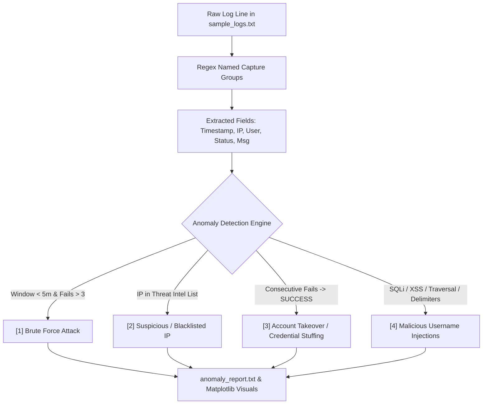

# Automated Log Parser for Anomalous Login Detection

[](https://www.python.org/)
[](LICENSE)
[]()
[]()
[]()

> **Suggested GitHub Repository Name:** `automated-log-parser-anomaly-detection`  
> **Simulation Purpose:** Practical proof of AI-assisted engineering and cybersecurity data analysis for technical workflow assessments.

---

## 📌 Project Overview
In modern corporate environments and cloud infrastructures, authentication and access logs serve as the first line of defense against cyber threats. However, raw server logs are unstructured, high-volume, and time-intensive to audit manually.

**Automated Log Parser for Anomalous Login Detection** is an end-to-end Python-based cybersecurity data analysis tool designed for beginners and security analysts. Utilizing regular expressions (`re`), standard data science libraries (`pandas`, `matplotlib`), and modern AI-augmented development practices, this project parses raw system access logs, normalizes telemetry, extracts security indicators, and flags critical intrusion attempts in real time.

---

## 🎯 Key Skills Demonstrated
This project directly proves proficiency in essential modern security analytics and engineering competencies:

- **Python Programming:** Clean, modular, type-hinted code following PEP 8 conventions with zero unnecessary dependencies for core parsing.
- **Regex-Based Text Processing:** Advanced regular expressions utilizing named capture groups (`(?P<name>...)`), non-greedy quantifiers, character classes, and boundary validation.
- **Log Analysis:** Structuring raw, semi-structured syslog and auth records into normalized tabular records with temporal indexing.
- **Basic Anomaly Detection:** Rule-based heuristics for threat detection, sliding-window temporal correlation, and behavioral sequence tracking.
- **Data Analysis Workflows:** Exploratory data analysis (EDA), metric aggregation, grouping, and communicative data visualizations using `pandas` and `matplotlib`.
- **AI-Assisted Development:** Strategic leverage of **GitHub Copilot** (for regex acceleration, boilerplate logic, and synthetic log prototyping) and **ChatGPT** (for incident triage threat modeling, SOC reporting architecture, and documentation alignment).

---

## 🛠️ Tool Stack & Technologies
| Category | Technology | Purpose |
|---|---|---|
| **Language** | Python 3.10+ | Core scripting and analytical logic |
| **Parsing Engine** | Python `re` Module | High-performance regex log extraction |
| **Data Manipulation** | `pandas` | Tabular aggregation, frequency sorting, sliding window grouping |
| **Data Visualization** | `matplotlib` | Multi-panel visual dashboards (donut, bar, timeline charts) |
| **Notebook Environment** | Jupyter Notebook (`.ipynb`) | Interactive problem walkthrough and reproducible analysis |
| **AI Assistants** | GitHub Copilot & ChatGPT | Regex generation, code optimization, threat modeling |

---

## 📂 Repository Structure
```text
Automated-Log-Parser/
│
├── sample_logs.txt             # Realistic simulated authentication logs (130+ entries)
├── log_parser.py               # Documented Python parser, anomaly detector & CLI reporter
├── anomaly_report.txt          # Exported security audit summary and incident breakdown
├── requirements.txt            # Project dependencies (pandas, matplotlib, ipykernel)
├── README.md                   # Complete documentation and assessment proof
└── Automated_Log_Parser.ipynb  # Interactive Jupyter notebook with embedded charts & EDA
```

---

## 🛡️ Anomaly Detection Rules & Scenarios
The parser inspects every authentication record against four real-world threat vectors:



### 1. Brute Force Attacks (>3 Failed Logins in Short Window)
- **Concept:** Rapid automated attempts to guess passwords.
- **Detection Logic:** A sliding 5-minute time window per source IP. If consecutive failures exceed the threshold (default: 3), an incident alert is raised.
- **Example in Data:** IP `198.51.100.23` launching 6 rapid failed attempts against the `admin` account in under 90 seconds.

### 2. Logins from Suspicious / Blacklisted IP Addresses
- **Concept:** Connections originating from known malicious infrastructure, botnet command-and-control (C2) servers, or high-risk anonymity proxies (Tor).
- **Detection Logic:** Direct cross-referencing against simulated threat intelligence watchlists.
- **Example in Data:** IP `203.0.113.195` (Botnet C2) probing accounts and `198.51.100.77` (Tor exit node) logging into user `emma`.

### 3. Repeated Failures Followed by a Success (Account Takeover)
- **Concept:** An attacker conducts credential stuffing or dictionary attacks until hitting the correct password, gaining unauthorized access.
- **Detection Logic:** Tracks sequential status transitions for each `(IP, Username)` pair. Flags when $\ge 3$ failures precede an immediate `SUCCESS`.
- **Example in Data:** IP `185.220.101.5` executing 4 failed attempts on `finance_lead` before successfully logging in at `09:20:23`.

### 4. Invalid / Malicious Username Patterns (Injection Probes)
- **Concept:** Attackers injecting web application payloads into login input fields hoping to trigger backend vulnerabilities.
- **Detection Logic:** Regular expressions targeting:
  - **SQL Injection:** `' OR '1'='1`, `admin'--`
  - **Cross-Site Scripting (XSS):** `<script>alert(1)</script>`
  - **Directory Traversal:** `../../etc/passwd`
  - **Command Injection:** `root;id`
  - **Illegal Syntax:** Characters outside standard alphanumeric, dot, dash, and underscore conventions.

---

## 🚀 Installation & Quickstart

### Prerequisites
- Python 3.10 or higher installed on your system
- Git (optional, for cloning)

### 1. Clone the Repository
```bash
git clone https://github.com/<your-username>/automated-log-parser-anomaly-detection.git
cd automated-log-parser-anomaly-detection
```

### 2. Install Dependencies
```bash
pip install -r requirements.txt
```

### 3. Run the Automated Log Parser Script
Execute the standalone Python script to parse logs, run anomaly detection, and generate the audit report:
```bash
python log_parser.py
```

### 4. Launch the Interactive Jupyter Notebook
To review the step-by-step data analysis, narrative explanations, and charts:
```bash
jupyter notebook Automated_Log_Parser.ipynb
```
*(Or open directly in VS Code / GitHub's built-in notebook viewer).*

---

## 📊 Sample Output & Verification

When running `python log_parser.py`, the script outputs a comprehensive security audit report both to the terminal and saves it to `anomaly_report.txt`:

```text
==============================================================================
       AUTOMATED LOG PARSER - ANOMALOUS LOGIN DETECTION REPORT
       Generated on: 2026-11-23 18:47:07
==============================================================================

1. EXECUTIVE SUMMARY
------------------------------------------------------------------------------
  Total Log Records Analyzed    : 130
  Successful Logins             : 108 (83.1%)
  Failed Logins                 : 22 (16.9%)
  Total Security Anomalies Found: 15

2. SECURITY ANOMALIES BREAKDOWN
------------------------------------------------------------------------------
  [A] Brute Force Incidents (>3 failures in window)    : 3
  [B] Known Suspicious IP Contacts                     : 5
  [C] Account Takeovers (Repeated Fails -> Success)    : 1
  [D] Invalid / Malicious Username Probes              : 6

3. DETAILED ANOMALY FINDINGS
------------------------------------------------------------------------------
>>> [A] BRUTE FORCE ATTACKS:
  1. Source IP    : 198.51.100.23
     Target User(s): admin
     Failed Attempts: 6
     Time Window   : 2026-11-23 08:31:23 to 2026-11-23 08:32:53
     Details       : Detected 6 rapid failed login attempts from IP 198.51.100.23 within 5 minutes.

>>> [B] LOGINS FROM SUSPICIOUS / BLACKLISTED IPs:
  1. Timestamp : 2026-11-23 08:51:38
     IP Address: 203.0.113.195 (Known Botnet Command & Control (C2) node)
     User / Status: guest [FAILED]

>>> [C] ACCOUNT TAKEOVER / CREDENTIAL STUFFING (FAILS FOLLOWED BY SUCCESS):
  1. Compromised Account: finance_lead
     Attacker IP        : 185.220.101.5
     Preceding Failures : 4
     Breach Timestamp   : 2026-11-23 09:20:23
     Details            : Account Takeover Alert: 4 failed attempts followed immediately by SUCCESS.

>>> [D] MALICIOUS / INJECTION USERNAME PROBES:
  1. Injected Value: admin' OR '1'='1     | Threat: Potential SQL Injection
  2. Injected Value: <script>alert(1)</script> | Threat: Cross-Site Scripting (XSS) probe
  3. Injected Value: ../../etc/passwd       | Threat: Directory Traversal probe
  4. Injected Value: root;id                | Threat: Command Injection delimiter

4. TOP TRAFFIC STATISTICS
------------------------------------------------------------------------------
  Top 5 Source IP Addresses (Total Activity):
    - 192.168.1.10      : 17 requests
    - 10.0.0.50         : 16 requests
    - 10.0.0.55         : 16 requests
```

---

## 📈 Included Visualizations (Notebook)
The `Automated_Log_Parser.ipynb` notebook renders four diagnostic charts:
1. **Authentication Status Ratio:** Donut chart contrasting 83.1% legitimate traffic vs 16.9% failure incidents.
2. **Top Source IPs Comparison:** Side-by-side horizontal bar chart differentiating benign corporate subnets from high-failure attack IPs.
3. **Anomaly Frequency Breakdown:** Categorical bar plot illustrating the volume of attacks across injection, proxy, brute-force, and account takeover vectors.
4. **Temporal Attack Timeline:** Timeline scatter plot mapping access attempts with color-shaded threat zones.

---

## 🎓 Learning Outcomes
1. **Regex Mastery:** Learned how to transform complex, multi-field log strings into structured data objects using named capture groups.
2. **Security Telemetry:** Understood the anatomy of authentication telemetry and how to compute indicators of compromise (IOCs).
3. **Algorithmic Defense:** Formulated sliding-window and sequential state algorithms to catch attacks that bypass simple count filters.
4. **AI-Assisted Workflow:** Experienced how AI tools (GitHub Copilot and ChatGPT) enhance engineering velocity while retaining rigorous code validation and domain security standards.

---

## 📄 License
This project is open-source and available under the [MIT License](LICENSE).
